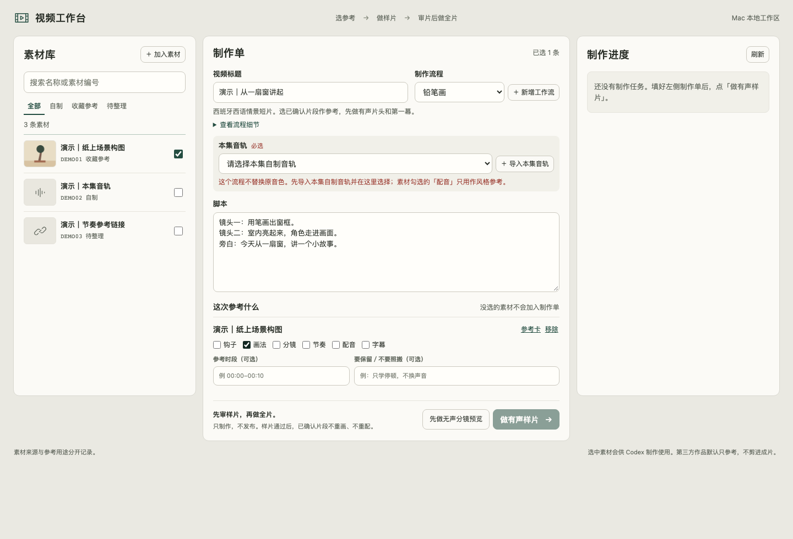
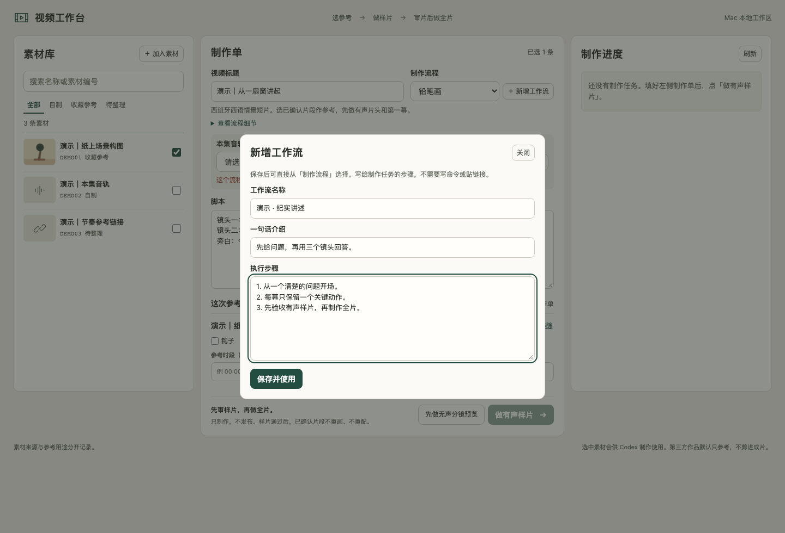
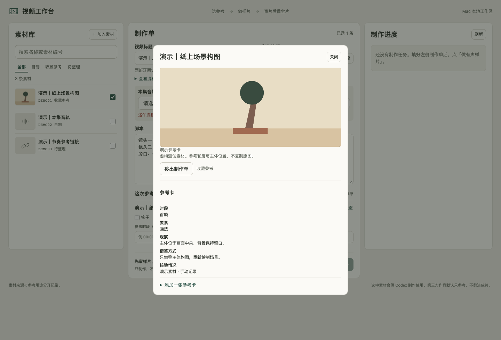

# 视频工作台 · Codex Video Workbench for macOS

在 Mac 本地组织素材、选择制作流程、指定本集音轨，再调用 Codex 做样片。用户审过有声样片后才制作全片，工作台不代发布。

## 新功能：视频结构卡（本地预览） · Video Structure Cards (Preview)

**把参考视频里值得借鉴的一招，变成下一条视频的脚本与分镜。** 本地导入一条视频，点击时间戳核对观察，勾选想复用的钩子或节奏，存为工作流，再用自己的新主题与内容生成可编辑草案。

**Turn one useful technique from a reference video into your next script and storyboard.** Import a clip, review timestamped evidence, save selected techniques as a reusable workflow, and apply it to your own topic and notes.

**在 Mac 上试用**（使用独立数据目录，不覆盖日常素材库）：

```sh
python3 server.py --port 8879 --data-dir ../video-workbench-preview-data
```

打开 <http://127.0.0.1:8879/> → **选择视频** → 回看并保存结构 → 选一个借鉴维度并保存工作流 → 填新主题和自己的「画面动作｜台词」→ 生成草案。结构分析和分镜规则不需要 Codex 登录；进入实际视频制作才需要。Python 3.11+、FFmpeg 和 FFprobe 为基础依赖；画面文字识别需要可选的 Tesseract，台词转写需要本机兼容的 Whisper CLI 和模型（用 `VIDEO_WORKBENCH_WHISPER_CLI`、`VIDEO_WORKBENCH_WHISPER_MODEL` 指定），不随仓库分发。

- 支持 MP4、MOV、WebM，单文件小于 128 MB，首轮分析最长 60 秒。对连续动画可能漏检镜头，混合语言转写和文字识别需要回看核对。文件选择已实测，Finder 拖放未验收。
- 分镜使用本机规则套用你自己的内容，不是自动剪辑或生成成片。结构分析不上传源视频；后续调用 Codex 制作属于独立联网流程。
- Preview: this is a local analysis and editable storyboard draft, not end-to-end video generation. Shot detection and transcription may miss details. Use the file picker for the verified import path.

## 20 秒真实演示 · 20-second demo

https://github.com/user-attachments/assets/218a463a-18db-483f-a519-fd15590d3fae

前 8 秒回放真实操作（约 2 倍速，等待已剪去）；后 12 秒完整播放工作台实际生成的有声样片，保留原速、原声。这是样片，不是整集。

这段演示展示既有样片制作流程，不是上方新结构卡功能的演示。

8 seconds of real UI replay, followed by the complete 12-second sample at its original speed and with its original audio. This shows an existing production task, not a video generated in 20 seconds.

## 可以做什么

- **管理参考素材**：导入自己的视频、图片或音频，也可登记第三方作品链接。仅参考勾选的画法、分镜、节奏、配音等维度；外链不会自动下载，第三方素材不会直接剪进成片。
- **记录具体借鉴**：在素材卡记录时间段、观察事实、要借鉴之处和验证依据。能从有权使用的本地视频提取音频并播放；可选的本机 Whisper 可以转写，中西语混合时可选语言分段重跑。声学指标不是人工试听。
- **选择或新增工作流**：默认带「铅笔画」制作规则。可写自己的工作流规则，随后从制作单选择；导入说明不安装软件，也不会自动接通 Seedance 等付费生成服务。
- **指定本集音轨**：选你有权使用的成品 WAV、MP3 等音轨。本项目不自动合成新台词；勾选参考素材的配音不能充当本集音轨。没有音轨时可先做无声分镜，不能用无声分镜直接启动全片。
- **审片、再做全片**：浏览器里查看任务和可播样片；点通过才启动全片。程序校验最终视频保留已确认段，失败会显示原因。







以上截图是使用虚构素材在本地应用中截取的界面，不含个人素材，不代表已生成或通过审阅的样片。

## 启动

1. Mac 安装 Python 3.11+、FFmpeg/FFprobe。浏览器页面与素材库存储在本机，没有额外工作台服务端账号。
2. 确认 Codex CLI 已安装并登录。应用会查找 PATH 上的 `codex`，并尝试 ChatGPT Mac 客户端随附的 CLI。真实制作仍需要 Codex 联网及可用额度；这里的「本地」不代表模型离线。
3. Finder 双击 `打开视频工作台.command`；或在项目目录运行 `python3 server.py --port 8765` 后打开 <http://127.0.0.1:8765/>。制作时保留启动窗口。
4. 在界面导入你自己的素材和音轨。除上方已确认的演示视频外，源代码仓库不附个人素材库或历史制作任务。若本机已有适用的「铅笔画」Skill，保留其现有配置；流程依赖的资源必须可用。

本地转写需要兼容的 Whisper 命令和模型，不随仓库分发；没有模型仍可提取并试听音频。不要将隐私或无权外传的素材用于联网制作。

## 开发验收

```sh
python3 -m unittest discover -s tests -v
node --check ui/app.js
node --check ui/analysis.js
```

测试包含回环 HTTP；开发沙箱可能需要允许临时监听 `127.0.0.1`。此工具不是对外网站，不应将监听地址改成公网。公开内容仅含程序、测试、文档、示意截图及经确认的演示视频；原始素材库、音频模型、任务、索引和账户信息均保留在本机。
